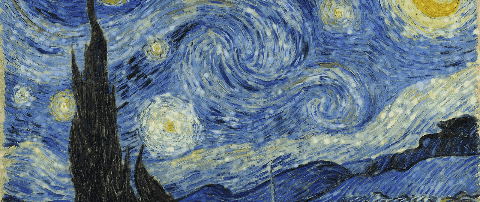

<!-- Profile README — hiển thị tại https://github.com/croznnt -->

  

Vincent van Gogh · <i>The Starry Night</i> (1889, public domain) — animated brushstroke particle-flow

<h1 align="center">Hi there, I'm Ngoc-Truc Nguyen 👋</h1>
<h3 align="center">Lecturer & Researcher · Ho Chi Minh City University of Transport</h3>

<i>Marine & offshore engineering · Control systems · Industrial management</i>

  
  
  

---

### 👨‍🏫 About me

- 🎓 **Lecturer and researcher** at Ho Chi Minh City University of Transport.
- 🚢 My research spans **marine & offshore engineering**, **control & automation systems**, and **machine/deep learning** — from dynamic positioning to data-driven modeling.
- 🏭 I also teach **industrial & operations management**, where I build hands-on tools that turn production data into **KPIs** for the classroom.
- 🔬 I enjoy bridging **theory and practice**: control algorithms, data acquisition, and decision-support dashboards.
- 💬 Ask me about **model predictive control, deep learning, marine electrical systems, OEE/Lean, or research with Python & MATLAB**.

---

### 🔬 Research interests

🤖 **Machine learning & deep learning** — data-driven modeling, prediction, computer vision  
🎛️ **Control & automation systems** — model predictive control (MPC), optimal & robust control  
🚢 **Marine & offshore engineering** — dynamic positioning, offshore platforms  
🌊 **Marine science** — ocean & marine systems  
⚡ **Marine electrical & power** — shipboard power, synchronous generators, AVR  
📡 **Data acquisition & monitoring** of marine structures  
🏭 **Industrial & operations management** — KPIs, OEE, Lean, quality

**Selected research topics**
- 🛳️ Model predictive control for **dynamic positioning of semi-submersible platforms** (with thruster constraints)
- 📡 **Data acquisition systems** for monitoring marine structures
- ⚡ Control-parameter optimization of **automatic voltage regulators (AVR)** for marine synchronous generators

> 📚 Full publication list on [ResearchGate](https://www.researchgate.net/profile/Ngoc-Truc-Nguyen-2).

---

### 🛠️ Tools I research & teach with

  &nbsp;&nbsp;
  &nbsp;&nbsp;
  &nbsp;&nbsp;
  &nbsp;&nbsp;
  &nbsp;&nbsp;
  &nbsp;&nbsp;
  &nbsp;&nbsp;
  &nbsp;&nbsp;
  &nbsp;&nbsp;
  &nbsp;&nbsp;
  &nbsp;&nbsp;
  &nbsp;&nbsp;
  &nbsp;&nbsp;
  &nbsp;&nbsp;
  

Python · PyTorch · TensorFlow · Keras · scikit-learn · OpenCV · NumPy · Pandas · Matplotlib · Plotly · Streamlit · Jupyter · MATLAB/Simulink · LaTeX · Git

---

### 🚀 Featured project

> **Manufacturing KPI Dashboard** — a Streamlit app + sample dataset that computes and
> evaluates 17 production KPIs **quarter by quarter** (OEE, quality, maintenance,
> productivity, finance, supply chain, safety). Built as a teaching demo for
> industrial management courses.

---

### 📈 GitHub stats

  
  

---

### 📫 Reach me

  
  
  

<i>“Bridging control theory, marine systems, and data-driven decisions.”</i>

